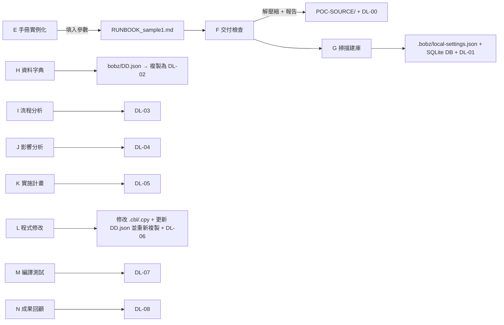

# Bob + PPZ POC — 專案資料夾說明

本文件說明專案資料夾在 POC 前後的樣貌，以及各步驟卡（E–N）對檔案系統的影響。
規則依據：[`AGENTS.md`](AGENTS.md)、[`RUNBOOK.md`](RUNBOOK.md)。
參考來源與證據對照：[`RESOURCES.md`](RESOURCES.md)。CR 目錄範本目前僅供參考，暫無強制填寫要求。

## 階段概覽（核心原則）

- **預期客戶提供**：CR 需求變更單（email / Word）＋ 程式碼壓縮包（`.zip`）
- **現場操作流程**：Git 開新分支，執行 `RUNBOOK_xxx.md`（僅 步驟卡 E – N）
    - 階段流程參考：[`RUNBOOK.md`](RUNBOOK.md) "1.1 端到端流程"。
- **預期交付**：可參考本文件「[二、After](#二after全部步驟卡-en-完成後的預期狀態)」交付物清單（`delivery-output/` 之 DL-00 至 DL-08）＋ 1 份 Word 報告（各步驟截圖存證）

## 一、Before（POC 開始前的狀態）

```
Bob-PPZ_POC/
├── AGENTS.md                      ← 已存在（POC 規則，不可被 /init 覆蓋）
├── .gitignore                     ← 已存在（排除暫存、掃描產物、交付壓縮檔、憑證）
├── zapp.yaml                      ← 已存在（Z Open Editor 設定：COPY／PROC 搜尋路徑，指向 POC-SOURCE/**）
├── README.md                      ← 本文件
├── RUNBOOK.md
├── CR/
│   └── CR-sample1.md                  ← 變更需求單（退票手續費計算規則分級調整）
├── client-discussion-doc/         ← 訪談／註冊／防火牆文件（PDF、PPTX）
├── POC-SOURCE/                    ← 空（等待客戶交付包解壓縮）
├── delivery-output/               ← 空（等待 DL-xx 交付物）
├── .bob/
│   ├── skills/brief-report/       ← 專案自訂技能（/brief-report，產生 _brief 精簡版）
│   └── tmp/
└── .git/
```

> **版本控制建議**：收到客戶交付物時，建議由 `master` 建立本機專屬分支（如 `git checkout -b cr/ub-fee-change`），並於生成手冊與解壓縮後建立基準 Commit，以隔離通用範本。版控僅限本機，不可 push 至外部平台。

## 二、After（全部步驟卡 E–N 完成後的預期狀態）

```
Bob-PPZ_POC/
├── AGENTS.md                      ← 不變（/init 不可覆蓋）
├── .gitignore                     ← 不變（見下方「版控範圍」）
├── zapp.yaml                      ← 不變（若程式碼放在其他資料夾，須同步修改 locations）
├── README.md
├── .bob/skills/brief-report/      ← 專案技能，需提交版控
├── RUNBOOK.md                   ← 通用手冊模板
├── RUNBOOK_sample1.md             ← 步驟卡 E 實例化手冊（收到 CR 單與 Zip 後由 Bob 填入參數生成）
├── CR/…
├── client-discussion-doc/…
│
├── UNION_BANK_POC.zip             ← 步驟 F：客戶交付壓縮包（放置後解壓）
│
├── POC-SOURCE/                    ← 步驟 F：解壓縮結果
│   ├── cobol/      (*.cbl, *.cob)   ← 步驟 L 修改 CHKRTN01.cbl
│   ├── copybook/   (*.cpy)          ← 步驟 L 修改 CHKFEE01.cpy
│   ├── jcl/        (*.jcl)
│   ├── proc/       (*.proc)
│   ├── other/      (選用：BMS、DBD/PSB、DCLGEN)
│   ├── MANIFEST.csv
│   └── README.txt
│
├── .bobz/                         ← 步驟 G 產生
│   ├── local-settings.json          ← databaseLocation 指向 SQLite 路徑
│   └── (SQLite 分析資料庫，例如 ScannerOutput_result.db，
│        或由 databaseLocation 指到鄰近資料夾)
│
├── bobz/
│   └── DD.json                    ← 步驟 H：工作字典（技能實際讀寫的來源）
│
├── IMPACT-ANALYSIS.md             ← 步驟 J 原始輸出（≤1000 行），歸檔為 DL-04
├── implementation-plan.md         ← 步驟 K 原始輸出（≤1000 行），歸檔為 DL-05
│
└── delivery-output/               ← 所有交付物集中處
    ├── DL-00-delivery-check.md           (F 交付完整性檢查報告，唯一存放位置)
    ├── DL-01-scan-summary.md             (G 掃描摘要／相依關係)
    ├── DL-02-data-dictionary.json        (H 由 bobz/DD.json 複製，僅供交付)
    ├── DL-03-CHKRTN01-explanation.md     (I 流程分析／業務規則)
    ├── DL-03-CHKRTN01-explanation_brief.md  (I 精簡版，選用)
    ├── DL-04-impact-analysis.md          (J 影響分析)
    ├── DL-04-impact-analysis_brief.md    (J 精簡版)
    ├── DL-05-implementation-plan.md      (K 實施計畫)
    ├── DL-05-implementation-plan_brief.md   (K 精簡版)
    ├── DL-06-review-record.md            (L Diff 與審查紀錄)
    ├── DL-06-review-record_brief.md      (L 精簡版)
    ├── DL-07-test-results.md             (M 主機測試結果)
    ├── DL-07-test-results_brief.md       (M 精簡版)
    └── DL-08-POC-review-report.md        (N 成果回顧，含 Precision／Recall)
```

> `DL-02-data-dictionary.json` 只是 `bobz/DD.json` 的複本，用 `Copy-Item -Path "bobz/DD.json" -Destination "delivery-output/DL-02-data-dictionary.json" -Force` 同步。
> 請勿直接編輯複本；步驟 L 新增欄位後須重新複製。
> `_brief` 精簡版由 `/brief-report 〈底稿路徑〉` 產生，供人閱讀。**不取代底稿**，核准與追溯以底稿為準。K、L 的精簡版在審閱／核准**之前**產生，底稿有修改須重新產生。
>
> **版控注意**：`.bob/skills/brief-report/` 若未提交，切換分支後技能不會出現。需與 `RUNBOOK.md` 一併提交。

### 版控範圍（依 `.gitignore`）

| 類別 | 路徑 | 版控 |
|---|---|---|
| 不進版控 | `.bob/tmp/`、`.bobz/expanded/`、`.bobz/expanded-single/`、`.bobz/local-settings.json` | 暫存，可重新產生 |
| 不進版控 | `WCA4ZTMIOutput/`、`*.db`、`*.db-journal` | 掃描資料庫，可重新產生 |
| 不進版控 | `*.zip`、`*.7z`、`*.rar` | 客戶交付壓縮檔（密碼保護） |
| 不進版控 | `*.pem`、`*.key`、`*.pfx`、`.env`、`.env.*` | 憑證類，不得提交 |
| 進版控 | `bobz/DD.json`、`delivery-output/DL-*`、`CR/`、`RUNBOOK*.md`、`.bob/skills/`、`zapp.yaml` | 刻意追蹤 |

> **`zapp.yaml` 路徑注意**：`locations` 目前是 `POC-SOURCE/**`。若交付包解壓到其他資料夾（例如 `sample1-source/POC-SOURCE/`），編輯器可能找不到 COPY 檔，造成 `zopeneditor-*` 工具與 COPY 展開結果不完整。是否需要修改，**尚未驗證**，請在步驟 F 解壓縮後確認。

> `.bobz/local-settings.json` 被忽略，因此換機器或重新 clone 後須重新掃描建庫（步驟 G）。

## 三、各步驟卡對檔案系統的影響



| 步驟 | 新增 | 修改 |
|---|---|---|
| E | `RUNBOOK_sample1.md`（專屬實例化手冊） | — |
| F | `POC-SOURCE/*`、`DL-00` | — |
| G | SQLite 資料庫、`DL-01` | `.bobz/local-settings.json` |
| H | `bobz/DD.json`、`DL-02`（複製） | — |
| I | `DL-03`、`DL-03_brief`（選用） | — |
| J | `DL-04`（原 `IMPACT-ANALYSIS.md`）、`DL-04_brief` | — |
| K | `DL-05`（原 `implementation-plan.md`）、`DL-05_brief` | — |
| L | `DL-06`、`DL-06_brief` | `CHKRTN01.cbl`、`CHKFEE01.cpy`、`bobz/DD.json`、`DL-02`（重新複製）、`DL-06_brief`（審閱後重產） |
| M | `DL-07`、`DL-07_brief` | — |
| N | `DL-08` | — |

## 四、文件維護規則（STE 精神）

本節供《RUNBOOK.md》的維護者使用。現場人員不需閱讀。

本版依 ASD-STE100（Simplified Technical English）的精神，用中文改寫。規則如下：

| 規則 | 做法 |
|---|---|
| 一句一事 | 每個步驟只寫一個動作。 |
| 短句 | 步驟句不超過 25 字。說明句不超過 35 字。 |
| 主動語氣 | 用祈使句開頭：「開啟」「輸入」「確認」。不寫被動句。 |
| 一詞一義 | 同一個東西只用同一個詞（見 `RUNBOOK.md` 0.3 用語表）。 |
| 警告在前 | 「警告」與「注意」放在相關步驟之前。 |
| 條件在前 | 先寫條件，再寫動作：「若……，則……」。 |
| 明確用詞 | 不用「適當」「必要時」「盡量」「視情況」。要寫出數字、名稱或條件。 |
| 步驟編號 | 一定要依順序做的動作用數字編號。 |
