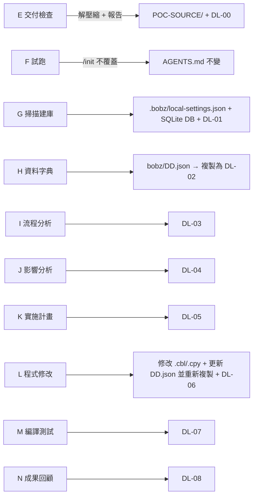

# Bob + PPZ POC — 專案資料夾說明

本文件說明專案資料夾在 POC 前後的樣貌，以及各步驟卡（E–N）對檔案系統的影響。
規則依據：[`AGENTS.md`](AGENTS.md)、[`operation-manual/cheatsheet.md`](operation-manual/cheatsheet.md)。
參考來源與證據對照：[`RESOURCES.md`](RESOURCES.md)。

## 一、Before（POC 開始前的狀態）

```
Bob-PPZ_POC/
├── AGENTS.md                      ← 已存在（POC 規則，不可被 /init 覆蓋）
├── README.md                      ← 本文件
├── operation-manual/
│   └── cheatsheet.md
├── CR-template/
│   ├── CR-template.md
│   └── CR-template_sample1.md
├── client-discussion-doc/         ← 訪談／註冊／防火牆文件（PDF、PPTX）
├── POC-SOURCE/                    ← 空（等待客戶交付包解壓縮）
├── delivery-output/               ← 空（等待 DL-xx 交付物）
├── .bob/tmp/
└── .git/
```

## 二、After（全部步驟卡 E–N 完成後的預期狀態）

```
Bob-PPZ_POC/
├── AGENTS.md                      ← 不變（步驟卡 F 的 /init 不可覆蓋）
├── README.md
├── operation-manual/cheatsheet.md
├── CR-template/…
├── client-discussion-doc/…
│
├── UNION_BANK_POC.zip             ← 步驟 E：客戶交付壓縮包（放置後解壓）
│
├── POC-SOURCE/                    ← 步驟 E：解壓縮結果
│   ├── cobol/      (*.cbl, *.cob)   ← 步驟 L 修改 CHKRTN01.cbl
│   ├── copybook/   (*.cpy)          ← 步驟 L 修改 CHKFEE01.cpy
│   ├── jcl/        (*.jcl)
│   ├── proc/       (*.proc)
│   ├── other/      (選用：BMS、DBD/PSB、DCLGEN)
│   ├── MANIFEST.csv
│   └── README.txt
│
├── .bobz/                         ← 步驟 G 產生
│   ├── local-settings.json          ← databaseLocation 指向 SQLite 路徑
│   └── (SQLite 分析資料庫，例如 ScannerOutput_result.db，
│        或由 databaseLocation 指到鄰近資料夾)
│
├── bobz/
│   └── DD.json                    ← 步驟 H：工作字典（技能實際讀寫的來源）
│
├── IMPACT-ANALYSIS.md             ← 步驟 J 原始輸出（≤1000 行），歸檔為 DL-04
├── implementation-plan.md         ← 步驟 K 原始輸出（≤1000 行），歸檔為 DL-05
│
└── delivery-output/               ← 所有交付物集中處
    ├── DL-00-delivery-check.md           (E 交付完整性檢查報告，唯一存放位置)
    ├── DL-01-scan-summary.md             (G 掃描摘要／相依關係)
    ├── DL-02-data-dictionary.json        (H 由 bobz/DD.json 複製，僅供交付)
    ├── DL-03-CHKRTN01-explanation.md     (I 流程分析／業務規則)
    ├── DL-04-impact-analysis.md          (J 影響分析)
    ├── DL-05-implementation-plan.md      (K 實施計畫)
    ├── DL-06-review-record.md            (L Diff 與審查紀錄)
    ├── DL-07-test-results.md             (M 主機測試結果)
    └── DL-08-POC-review-report.md        (N 成果回顧，含 Precision／Recall)
```

> `DL-02-data-dictionary.json` 只是 `bobz/DD.json` 的複本，用 `Copy-Item -Path "bobz/DD.json" -Destination "delivery-output/DL-02-data-dictionary.json" -Force` 同步。
> 請勿直接編輯複本；步驟 L 新增欄位後須重新複製。

## 三、各步驟卡對檔案系統的影響



| 步驟 | 新增 | 修改 |
|---|---|---|
| E | `POC-SOURCE/*`、`DL-00` | — |
| F | 無（只讀） | `AGENTS.md` 不可被覆蓋 |
| G | SQLite 資料庫、`DL-01` | `.bobz/local-settings.json` |
| H | `bobz/DD.json`、`DL-02`（複製） | — |
| I | `DL-03` | — |
| J | `DL-04`（原 `IMPACT-ANALYSIS.md`） | — |
| K | `DL-05`（原 `implementation-plan.md`） | — |
| L | `DL-06` | `CHKRTN01.cbl`、`CHKFEE01.cpy`、`bobz/DD.json`、`DL-02`（重新複製） |
| M | `DL-07` | — |
| N | `DL-08` | — |
