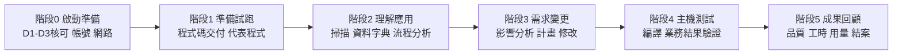

# Bob + PPZ POC 現場操作小抄（Field Cheat Sheet）

| 項目 | 內容 |
|---|---|
| 版本 | v1.0（草稿，供現場試用後修訂） |
| 適用對象 | 聯邦銀行 POC 現場人員：客戶程式／業務專家、主機窗口、資安窗口、Bob／PPZ 顧問 |
| 適用情境 | IBM Bob IDE + Premium Package for Z（PPZ），Local Workspace 模式（不建中央 Z Understand） |
| 參考依據 | 《POC 需求訪談簡報》、《防火牆與 AP 開發機需求 20261007》、《IBMid 註冊操作指南》、《變更請求範本》，以及 Bob 內建技能（資料字典、影響分析、實施計畫） |
| 使用方式 | 先看第 1 節總覽定位目前階段 → 到對應「步驟卡」逐項勾選 → 出狀況查第 5 節應急總表 |

> **提醒**：本小抄的畫面名稱、指令與路徑以現場實際安裝版本為準；若與畫面不同，請以畫面為準並回報修訂。

---

## 0. 速查圖例與角色代號

| 代號 | 角色 | 主要職責 |
|---|---|---|
| **BIZ** | 客戶業務專家 | 提供需求、已知答案、核對資料字典語意 |
| **DEV** | 客戶程式專家 | 交付程式碼、審閱修改內容 |
| **MF** | 客戶主機窗口 | 程式來源、測試環境、編譯與測試執行 |
| **SEC** | 客戶資安窗口 | 資料使用、雲端 AI 核可、網路開通 |
| **NET** | 客戶網路／端點窗口 | 防火牆、Proxy、工作站準備 |
| **BOB** | Bob／PPZ 顧問 | 帳號授權、掃描、分析、修改建議、成果回顧 |

| 符號 | 意義 |
|---|---|
| ☐ | 待確認（現場請勾選 ☑） |
| 🔴 | 卡關項目，未完成不得進入下一步 |
| 🟡 | 建議項目，可平行處理 |
| 🛑 | 禁止事項 |

---

## 1. 一頁總覽

### 1.1 端到端流程

### 1.2 階段與步驟卡對照

| 階段 | 步驟卡 | 主要負責 | 建議使用的 Bob 模式 | 階段完成判定 |
|---|---|---|---|---|
| 0 啟動準備 | A 核可 → B IBMid → C 網路 → D 安裝登入 | SEC／NET／BOB | 不適用 | Bob 能登入且完整回應一次對話 |
| 1 準備試跑 | E 程式碼交付 → F 代表程式試跑 | DEV／BOB | Z Architect／Z Code | 代表程式可被掃描且結果可回查來源 |
| 2 理解應用 | G 掃描 → H 資料字典 → I 流程分析 | BOB／BIZ／DEV | Z Architect | 資料字典經專家核對 |
| 3 需求變更 | J 影響分析 → K 實施計畫 → L 程式修改 | BOB／DEV | Z Architect → Z Code | 計畫經核准後才修改；修改經審閱 |
| 4 主機測試 | M 編譯與測試 | MF／BOB | Z Code | 邊界值測試結果符合預期 |
| 5 成果回顧 | N 回顧與結案 | BOB／全員 | 不適用 | 報告簽收；資料刪除完成 |

> **鐵則**：每一階段先確認結果，再往下推進；未完成主機測試的部分，一律標示「尚未驗證」。

### 1.3 模式選擇速查

| 想做的事 | 切換到 | 說明 |
|---|---|---|
| 看懂程式、畫圖、影響分析、寫實施計畫 | **Z Architect** | 只分析與文件化，**不改程式** |
| 改 COBOL／COPY／JCL、跑掃描與編譯類工具 | **Z Code** | 才可編輯原始碼 |
| 問 Bob 功能或一般問題 | **Ask** | 唯讀 |

---

## 2. 啟動前總檢核（Go／No-Go）

> 下列 🔴 項目任一未完成，**不得接收程式碼或啟動 AI 驗證**。

| # | 項目 | 等級 | 確認人 | 狀態 |
|---|---|---|---|---|
| 1 | D1：是否允許 Bob 連入主機（可採「客戶代操作」） | 🟡 | MF | ☐ |
| 2 | D2：是否允許程式下載至核准的 Bob＋PPZ 工作站 | 🔴 | MF | ☐ |
| 3 | D3：是否允許 Bob SaaS 使用必要內容協助理解 | 🔴 | SEC | ☐ |
| 4 | 資料使用範圍已定（程式片段／完整程式／須脫敏） | 🔴 | SEC | ☐ |
| 5 | 變更案例與驗收基準已選定（含已知答案的提供方式） | 🔴 | BIZ | ☐ |
| 6 | 每位使用者已有 IBMid 且 Email 與公司指定一致 | 🔴 | 各使用者 | ☐ |
| 7 | 防火牆／Proxy 已開通並完成登入＋對話驗證 | 🔴 | NET | ☐ |
| 8 | 程式碼交付清單（MANIFEST）與校驗碼備妥 | 🔴 | DEV | ☐ |
| 9 | 主機測試窗口、LPAR、測試資料已預約 | 🟡 | MF | ☐ |
| 10 | 各窗口聯絡方式與緊急聯絡人已確認 | 🟡 | 專案負責人 | ☐ |

> 🛑 以下資料**不得**交給 Bob 處理：個人敏感資料（SPI）、個人健康資料、可識別的帳號／卡號／身分證號等敏感金融資料、尚未公開的重大資訊，以及非 IBM 授權範圍的第三方智慧財產。程式碼須先依 SEC 核可的規則脫敏。

---

## 3. 步驟卡（每步：前置條件 → 具體動作 → 預期結果 → 應急處理）

### 步驟卡 A：取得三項核可（D1／D2／D3）

| 欄位 | 內容 |
|---|---|
| **負責** | MF（D1、D2）、SEC（D3） |
| **前置條件** | 變更請求已提交；範圍（子流程、語言、元件）已列明 |
| **具體動作** | 1. 逐項說明用途：D1 主機連線、D2 程式落地、D3 雲端 AI 理解。 2. 各核可人於變更請求第 6.1 節填寫結果、日期與限制條件。 3. 若 D1 不允許，改採「客戶代操作＋結果回傳」，並預先準備步驟清單。 |
| **預期結果** | D1–D3 皆有明確結果與核可人簽署；D2、D3 為「允許」 |
| **應急處理** | **D2 或 D3 未核可** → 暫停接收程式碼；先以已脫敏的小範圍樣本申請試跑。 **D1 不允許** → 啟動「代操作」流程，並於風險表登記測試階段可能延遲。 **核可有附帶限制** → 將限制寫入備註，後續步驟逐項遵守。 |

---

### 步驟卡 B：IBMid 註冊與確認

| 欄位 | 內容 |
|---|---|
| **負責** | 每位使用者；BOB 協助 |
| **前置條件** | 持有公司指定 Email 並可收信 |
| **具體動作** | 1. 開啟 IBMid 註冊頁，輸入 Email、名字、姓氏，國家選 **Taiwan**。 2. 公司欄位輸入 **Union Bank of Taiwan**，從建議清單選 UNION BANK OF TAIWAN。 3. 設定密碼（12–63 字元，含大寫、小寫、數字，不可全形字元）。 4. 到信箱收取寄件者為 ibmacct 的驗證信，輸入 **7 位數驗證碼**（30 分鐘內有效）。 5. 進入 My IBM 後，另開無痕視窗以同一 Email 重新登入。 6. 於 Profile 核對 IBMid 與 Email 皆為公司指定地址。 |
| **預期結果** | 能獨立登入 My IBM，Profile 顯示正確 Email；「您似乎沒有任何產品」屬正常，不需申請產品 |
| **應急處理** | **收不到驗證信** → 檢查垃圾郵件與公司郵件隔離區；回註冊頁按 resend e-mail，以最新信件為準；仍收不到請 NET 確認信件是否被攔截。 **驗證碼過期** → 重新寄送並使用最新驗證碼。 **Email 已有 IBMid** → 直接登入，不重複建立；若與公司指定 Email 不同，先向專案窗口確認應使用哪一個。 **忘記密碼** → 使用 IBM 官方密碼重設頁，重設後再確認可登入。 **已註冊但 Bob 不能用** → IBMid 與 Bob 使用權限是兩件事，請 BOB 確認授權設定。 |

---

### 步驟卡 C：防火牆與 Proxy 開通

| 欄位 | 內容 |
|---|---|
| **負責** | NET、SEC；BOB 提供清單 |
| **前置條件** | 已確認 Bob 訂閱區域（例如日本）；已知出口 Proxy 路徑 |
| **具體動作** | 1. 由使用者開發機（或核准的出口 Proxy）**向外**開通 **HTTPS／TCP 443**，採網域白名單（官方未提供固定 IP）。 2. 共同端點：`bob.ibm.com`、`api.us-east.bob.ibm.com`、`iam.cloud.ibm.com`、`console-ibm-prod.verify.ibm.com`、`idaas.ice.ibmcloud.com`、`www.ibm.com`、`login.ibm.com`、`myibm.ibm.com`。 3. 即使訂閱區域在日本或歐洲，仍須開通 `api.us-east.bob.ibm.com`（共用身分驗證位於美東）。 4. 依區域補上 `*.ice.ibmcloud.com` 等區域端點（可於實際登入時逐一補齊）。 5. 維持 Proxy Strict SSL 啟用；若有 TLS 檢查，由 NET／SEC 確認信任鏈（企業根憑證）。 |
| **預期結果** | 規則生效後，工作站可連到上述網域；尚待步驟卡 D 的實際登入驗證 |
| **應急處理** | **登入頁打不開** → 先在瀏覽器測試 `bob.ibm.com`、`login.ibm.com`，缺哪個補哪個。 **憑證錯誤（SSL）** → 不要關閉 Strict SSL 當作解法；請 NET 把企業根憑證加入信任鏈。 **僅部分端點可通** → 以實際登入流程觀察被擋的網域，逐一補開。 **需要證明連線方向** → 說明為 Outbound 連線，回應經既有連線返回，並請 NET 確認沿途 ACL 與回程路徑。 |

---

### 步驟卡 D：安裝 Bob IDE／PPZ 並完成登入驗證

| 欄位 | 內容 |
|---|---|
| **負責** | NET（工作站）、BOB（帳號授權與元件） |
| **前置條件** | 步驟卡 B、C 完成；工作站符合建議規格 |
| **具體動作** | 1. 檢查工作站：**16 GB RAM、近年 4 核心以上、SSD 可用空間 ≥ 20 GB**（官方最低 4 GB RAM／建議 8 GB／安裝至少 500 MB）。 2. 安裝與工作站作業系統相符的 Bob IDE。 3. 確認必要元件：PPZ、IBM Z Open Editor（建議 6.4.0 以上）、Zowe Explorer、Java 21 以上（64 位元）。 4. 重啟 Bob，完成瀏覽器登入並返回 IDE。 5. 在 Bob 面板發起一次簡單對話（例如「請用一句話自我介紹」），確認取得**完整回應**。 |
| **預期結果** | 登入成功、對話有完整回應；PPZ 相關功能（掃描、資料字典）可在 IDE 中看到 |
| **應急處理** | **登入後無法返回 IDE** → 檢查瀏覽器是否阻擋轉址；重啟 Bob 後重試。 **對話中斷或無回應** → 回步驟卡 C 檢查 Proxy／TLS；確認未被端點防護攔截。 **元件缺漏或版本不符** → 由 BOB 提供相容版本，NET 評估安裝權限。 **記憶體吃緊** → 關閉不必要程式；如同機另跑容器或虛擬機，評估升級至 32 GB。 |

---

### 步驟卡 E：程式碼交付與完整性檢查

| 欄位 | 內容 |
|---|---|
| **負責** | DEV（交付）、BOB（檢查） |
| **前置條件** | D2 已核可；SEC 已核可脫敏規則；工作區位置已定（例如 `D:\POC-SOURCE`） |
| **具體動作** | 1. 依建議結構整理：`cobol/`、`copybook/`、`jcl/`、`proc/`、`other/`、`MANIFEST.csv`、`README.txt`。 2. 保留原有成員名稱；在 MANIFEST 填寫檔名、類型、來源庫、版本日期、**SHA-256**、是否為變更目標。 3. 於 README 註明編碼（EBCDIC 轉 UTF-8 的編碼頁）、固定格式欄位（7–72）、COBOL 編譯器版本、COPY 搜尋順序、編譯選項。 4. 以核准的安全通道傳輸（例如 AES-256 加密壓縮檔，密碼另行通知）。 5. 收件後逐一比對檔案數量與校驗碼，並列出缺失項目（缺 COPY、動態 CALL 目標、外部模組）。 |
| **預期結果** | 檔案數量與校驗碼一致；缺失項目與動態呼叫已列入邊界清單 |
| **應急處理** | **校驗碼不符** → 要求重新傳送，不得使用不確定版本。 **缺 COPY 或 JCL／PROC** → 登記為邊界，判斷是否影響本變更；影響者請 DEV 補件。 **出現亂碼** → 確認編碼轉換（EBCDIC → UTF-8）與編碼頁；請 DEV 重新轉檔。 **含未脫敏資料** → 立即停止使用，通知 SEC，依其指示處置。 |

---

### 步驟卡 F：代表程式試跑

| 欄位 | 內容 |
|---|---|
| **負責** | BOB 主導，DEV／BIZ 共同檢視 |
| **前置條件** | 步驟卡 D、E 完成 |
| **具體動作** | 1. 選 1 支代表性 COBOL 與其 COPY 作為試跑對象。 2. 在 Z Architect 模式請 Bob 說明程式用途與主要規則（見第 4 節提示詞）。 3. DEV／BIZ 對照原始碼核對說明是否正確。 4. 記錄回應時間、記憶體使用、解析錯誤，作為後續配置依據。 |
| **預期結果** | 說明與原始碼相符，且可回查到程式段落；確認可進入完整分析 |
| **應急處理** | **說明與程式不符** → 要求 Bob 指出依據的行號；補充業務詞彙後重問。 **解析失敗** → 檢查編碼、固定格式欄位、COPY 搜尋順序；必要時縮小範圍再試。 **回應太慢** → 縮小提問範圍（單一段落或單一欄位）。 |

---

### 步驟卡 G：掃描程式碼、建立分析資料庫

| 欄位 | 內容 |
|---|---|
| **負責** | BOB |
| **前置條件** | 步驟卡 F 通過；**使用者已明確同意掃描**；工作區已開啟正確資料夾 |
| **具體動作** | 1. 先確認工作區設定中是否已有可用的資料庫（`local-settings.json` 的 `databaseLocation`）。 2. 沒有才詢問使用者同意，再對**上層資料夾**執行 `scan_program`（多種語言時依提示選擇）。 3. 掃描完成後確認資料庫路徑已寫入設定。 4. 以 `get_program_dependencies`、`get_paragraphs` 抽查數支程式的呼叫與段落是否合理。 |
| **預期結果** | 產生本機 SQLite 分析資料庫；程式、COPY、資料表、檔案的相依可查詢 |
| **應急處理** | **No supported files found** → 確認資料夾路徑與副檔名（`.cbl`／`.cob`／`.cobol`、`.pli`／`.pl1`）。 **使用者拒絕掃描** → 不得強制執行；改用編輯器的控制流程／資料流程工具做有限分析，並於報告註明限制。 **資料庫路徑錯誤** → 檢查設定檔路徑；必要時重新掃描。 **範圍太大逾時** → 分批掃描（先變更目標及其相依，再擴大）。 |

---

### 步驟卡 H：建立資料字典（反向工程）

| 欄位 | 內容 |
|---|---|
| **負責** | BOB 產出；BIZ／DEV 核對語意 |
| **前置條件** | 步驟卡 G 完成（資料庫存在） |
| **具體動作** | 1. 請 Bob 使用資料字典技能，對目標程式執行 `get_variables`（預設取前 15 個關鍵變數，可調整為 10–20）。 2. 依工具回傳的三步驟流程：選擇變數 → 展開縮寫 → 儲存。 3. 在差異檢視畫面逐項核對描述；有業務詞彙表或命名慣例檔時一併提供。 4. 儲存後確認產出 `DD.json`（常見位置 `bobz/DD.json`），並確認各項目的 `scope` 含目標程式名稱。 5. BIZ 針對手續費、金額等**關鍵欄位**簽核語意。 |
| **預期結果** | DD.json 涵蓋變更相關欄位，且有業務語意說明；之後讀取 COBOL／PL/I 時一併讀入 DD.json |
| **應急處理** | **get_variables 回傳錯誤** → 停止並回報錯誤內容，不要以人工猜測取代。 **差異檢視無變化** → 屬正常（欄位已存在且範圍已含此程式）。 **JSON 格式錯誤** → 檢查引號、逗號、`scope` 格式 `[{"programName":"PROG1"}]`。 **程式修改後字典過期** → 重新執行 `get_variables`，只會針對新增欄位提示。 |

---

### 步驟卡 I：流程分析與文件產生

| 欄位 | 內容 |
|---|---|
| **負責** | BOB；DEV／BIZ 核對 |
| **前置條件** | 資料字典已建立或已確認略過 |
| **具體動作** | 1. 在 Z Architect 模式，針對整支程式啟動「**Explain code**」工作流程（選擇架構師／業務／開發者視角）。 2. 需要正式文件時使用「**Generate program documentation**」；需要跨程式瀏覽時再用「**Generate application documentation**」。 3. 需要整理規則時使用「**Extract business rules**」。 4. 以 `zopeneditor-cobol-get-program-control-flow` 檢視段落流程，以 `zopeneditor-cobol-get-data-flow` 追蹤特定欄位（如手續費欄位）的讀寫位置。 |
| **預期結果** | 取得流程分析報告（DL-02）、相依圖與關鍵規則清單，且可回查來源 |
| **應急處理** | **整份解釋太冗長** → 改問指定行號範圍或單一段落。 **動態 CALL 無法解析** → 請 DEV 補充已知目標，仍未知者列入「尚未驗證」。 **語意爭議** → 以 BIZ 簽核為準，並更新資料字典。 |

---

### 步驟卡 J：影響分析

| 欄位 | 內容 |
|---|---|
| **負責** | BOB；DEV／BIZ 回答釐清問題 |
| **前置條件** | 變更需求清楚（現況、期望、驗收標準）；已知答案**尚未**給 Bob（保持評估客觀） |
| **具體動作** | 1. 在 Z Architect 模式要求「**影響分析**」，Bob 將啟動影響分析技能。 2. 先以本機資料庫的 SQL 查詢找出受影響的程式、COPY、表、檔案。 3. 針對變更欄位執行資料流程追蹤，找出上下游。 4. 回答 Bob 的 1–2 個釐清問題（例如是否有其他系統直接讀取同一張表）。 5. Bob 會詢問是否另用 Z Understand 做更廣泛分析；本次 Local 模式一般選「否」，除非另有安排。 6. 產出 `IMPACT-ANALYSIS.md`（DL-04），含相依圖、風險表、信心等級。 |
| **預期結果** | 受影響清單完整；動態呼叫、缺失來源、外部介面均明列邊界；信心等級有理由 |
| **應急處理** | **清單疑似漏列** → 請 DEV 補充可能的間接相依（共用 COPY、批次 JCL），重新查詢。 **清單疑似誤列** → 要求 Bob 附上依據（CALL／COPY／檔案存取位置）逐項驗證。 **報告過長（上限約 1000 行）** → 要求拆成多份聚焦報告。 |

---

### 步驟卡 K：實施計畫

| 欄位 | 內容 |
|---|---|
| **負責** | BOB；DEV 審閱 |
| **前置條件** | 步驟卡 J 完成；涉及程式皆有資料字典（缺漏者先補） |
| **具體動作** | 1. 要求「**建立實施計畫**」，Bob 將啟動實施規劃技能。 2. 回答 Bob 的開放問題（邊界值、例外情形、部署時機）。 3. 檢視計畫要點：目標與非目標、工作流、執行順序、受影響元件、風險、**測試策略**、**回退計畫**。 4. DEV、MF、BIZ 審閱並核准。 5. 計畫存為 `implementation-plan.md`（DL-05）。 |
| **預期結果** | 計畫逐項對應需求與測試案例；有回退步驟；經核准 |
| **應急處理** | **計畫缺測試案例** → 補入驗收基準（如面額 100,000／100,001 邊界值）。 **涉及程式缺資料字典** → 先在 Z Code 子任務補建，再回來定案。 **範圍蔓延** → 對照變更請求「範圍外」，超出者另提變更請求。 |

---

### 步驟卡 L：程式修改與審查（切換至 Z Code）

| 欄位 | 內容 |
|---|---|
| **負責** | BOB 產出建議；DEV 逐項審閱 |
| **前置條件** | 實施計畫已核准；原始碼已備份或在版控下 |
| **具體動作** | 1. 切換到 **Z Code** 模式（Z Architect 不改程式）。 2. 依計畫逐支修改，每次變更保持最小範圍。 3. 檢視差異（Diff），DEV 逐行確認，不可整批接受。 4. 修改後更新資料字典（如新增欄位）。 5. 彙整為 DL-06（修改後原始碼＋審查記錄）。 |
| **預期結果** | 修改僅限計畫範圍；DEV 簽核；可進入編譯 |
| **應急處理** | **Bob 修改超出範圍** → 拒絕該段差異，要求依計畫範圍重做。 **固定格式破版（超出 72 欄）** → 使用格式化工具或手動調整後再審。 **懷疑改錯** → 還原至備份版本，改以較小步驟重做。 |

---

### 步驟卡 M：主機編譯與測試（客戶操作並回傳）

| 欄位 | 內容 |
|---|---|
| **負責** | MF 執行；BOB 協助判讀 |
| **前置條件** | DEV 已核准修改；測試窗口、LPAR、測試資料、編譯 JCL／PROC 已備；D1 若不允許，則由客戶手動操作 |
| **具體動作** | 1. BOB 提供「編譯＋測試步驟清單」與預期結果（例如手續費 150／300／150／300，日終合計 900）。 2. MF 將修改後程式上傳測試環境，執行客戶既有編譯 PROC。 3. 執行測試 JCL，收集 SYSOUT 與比對報告。 4. 依約定格式**加密**後經核准通道回傳。 5. BOB 協助比對結果，記錄通過／失敗與尚未驗證項目（DL-07）。 |
| **預期結果** | 編譯無錯誤；邊界值測試與日終入帳結果符合預期 |
| **應急處理** | **編譯錯誤** → 回傳完整編譯訊息，由 Bob 協助定位，回步驟卡 L 修正。 **結果與預期不符** → 先確認測試資料與基準；再對照資料流程找出差異欄位。 **測試窗口失效** → 啟用備用日期；未測部分標示「尚未驗證」。 **回傳含敏感資料** → 先遮蔽再回傳，並通知 SEC。 |

---

### 步驟卡 N：成果回顧與結案

| 欄位 | 內容 |
|---|---|
| **負責** | BOB、全員 |
| **前置條件** | 步驟卡 M 完成或已明列未完成範圍 |
| **具體動作** | 1. 計算定位品質：**Precision＝找對 ÷ 工具列出；Recall＝找對 ÷ 已知應找**（建議門檻各 ≥ 80%）。 2. 此時才開啟密封的已知答案文件，由 BIZ／DEV 共同核對。 3. 彙整工時（含審查與修正）與 AI 用量，與人工基線比較；不預先承諾節省比例。 4. 彙整交付物 DL-01～DL-08 並簽收。 5. 結案後 14 天內（依實際約定）刪除工作站上的工作目錄，並書面確認。 |
| **預期結果** | 成果回顧報告簽收；資料刪除有書面紀錄 |
| **應急處理** | **未達 80% 門檻** → 如實呈現，分析漏列／誤列原因（缺來源、動態呼叫、語意落差），不調整答案遷就結果。 **無人工基線** → 以估算並註明；後續補正。 **刪除範圍有疑義** → 由 SEC 與 NET 共同確認清單後再執行。 |

---

## 4. 常用提示詞速查（可直接貼入 Bob 面板）

> 提示詞越具體，結果越穩定。請替換 `〈 〉` 內的內容。

| 目的 | 模式 | 提示詞範例 |
|---|---|---|
| 驗證登入 | 任一 | `請用一句話介紹你自己。` |
| 說明整支程式 | Z Architect | `請以架構師視角說明 〈CHKRTN01.cbl〉 的用途、主要處理步驟與關鍵業務規則，並標註對應段落。` |
| 說明片段 | Z Architect | `請說明 〈CHKRTN01.cbl〉 第 〈起〉 至 〈迄〉 行在做什麼，以及用到哪些欄位。` |
| 追蹤欄位 | Z Architect | `請追蹤 〈WS-FEE-AMT〉 在 〈CHKRTN01〉 中被讀取、寫入與傳遞的位置。` |
| 建立資料字典 | Z Architect | `請為 〈CHKRTN01〉 建立資料字典，聚焦與手續費相關的欄位。` |
| 影響分析 | Z Architect | `請針對「退票手續費依面額分級」進行影響分析，列出受影響的程式、COPY、表與批次，並標示邊界與未驗證項目。` |
| 實施計畫 | Z Architect | `請為上述變更建立實施計畫，包含測試案例（面額 100,000／100,001）與回退計畫。` |
| 修改程式 | Z Code | `請依已核准的實施計畫修改 〈CHKFEE01.cpy〉 與 〈CHKRTN01.cbl〉，限定在計畫範圍內，並列出差異供審閱。` |
| 判讀編譯錯誤 | Z Code | `以下是編譯訊息，請協助定位原因並提出最小修正：〈貼上訊息〉` |

---

## 5. 應急處理總表（依症狀查詢）

| 症狀 | 常見原因 | 立即動作 | 升級對象 |
|---|---|---|---|
| 無法登入 Bob | 防火牆未開通／IBMid 錯誤／Proxy 憑證 | 依序測 `login.ibm.com`、`bob.ibm.com`；確認 Email；查 TLS 信任鏈 | NET、SEC |
| 登入成功但對話無回應 | 端點被擋／網路不穩 | 重啟 Bob；檢查 Proxy 與回程路徑 | NET |
| 登入後仍無 Bob 權限 | IBMid 已註冊但尚未授權 | 提供畫面與錯誤訊息給 BOB 確認授權 | BOB |
| 掃描找不到檔案 | 路徑或副檔名錯誤 | 確認資料夾與副檔名；改掃上層資料夾 | BOB |
| 分析結果與程式不符 | 版本不一致／缺 COPY／編碼錯誤 | 比對 MANIFEST 校驗碼；補件；重轉編碼 | DEV |
| 動態 CALL 無法解析 | 執行期才決定目標 | 請 DEV 提供已知目標；其餘列「尚未驗證」 | DEV |
| 資料字典與程式不同步 | 程式修改後未更新 | 重跑 `get_variables` 更新 | BOB |
| 專家審查延遲 | 人手不足 | 依約定回覆時限（如 3 個工作天）催辦 | 專案負責人 |
| 主機測試窗口落空 | 排程衝突 | 啟用備用日期；未測項目標示「尚未驗證」 | MF |
| 發現含敏感資料 | 脫敏不完整 | **立即停止使用並通知 SEC**，依指示清除 | SEC |
| 回應品質不穩 | 提問太廣 | 縮小範圍、指定程式／行號／欄位，要求附依據 | BOB |
| Precision／Recall 未達標 | 缺來源／語意落差 | 如實呈現並分析原因，不調整答案 | 專案負責人 |

---

## 6. 現場紀錄表（可複製使用）

### 6.1 每日開工檢查

| 項目 | 結果 |
|---|---|
| 日期／場地／在場人員 | |
| 今日階段與步驟卡 | |
| Bob 登入與對話驗證 | ☐ 通過　☐ 異常：____ |
| 工作區版本與 MANIFEST 一致 | ☐ 是　☐ 否：____ |
| 今日預計產出 | |

### 6.2 事件紀錄

| 時間 | 步驟卡 | 症狀 | 處置 | 結果 | 負責人 | 是否升級 |
|---|---|---|---|---|---|---|
| | | | | | | |

### 6.3 決策與核可紀錄

| 日期 | 決策事項 | 結論 | 核可人 | 附帶限制 |
|---|---|---|---|---|
| | | | | |

### 6.4 尚未驗證項目清單

| 編號 | 項目 | 原因（動態呼叫／缺來源／未測試） | 後續處理 |
|---|---|---|---|
| | | | |

---

## 7. 收工前檢核與資料保護

| 項目 | 確認 |
|---|---|
| 今日產出已存檔（報告、DD.json、Diff），且命名含日期 | ☐ |
| 事件紀錄與尚未驗證清單已更新 | ☐ |
| 含程式碼的檔案僅存放於核准工作區 | ☐ |
| 回傳或交付檔案已加密，密碼另行通知 | ☐ |
| 未將程式碼或結果貼入未核可的外部工具 | ☐ |
| 明日預計步驟與所需窗口已通知 | ☐ |

---

## 8. 交付物對照（驗收用）

| 編號 | 交付物 | 對應步驟卡 | 驗收人 |
|---|---|---|---|
| DL-01 | 程式掃描結果／相依關係圖 | G | DEV |
| DL-02 | 流程分析報告 | I | BIZ |
| DL-03 | 資料字典 | H | BIZ、DEV |
| DL-04 | 影響分析報告 | J | 專案負責人 |
| DL-05 | 實施計畫 | K | 專案負責人 |
| DL-06 | 程式修改建議（Diff） | L | DEV |
| DL-07 | 主機測試結果 | M | MF |
| DL-08 | 成果回顧報告 | N | 專案負責人 |

---

*本小抄整理自專案文件與 Bob 內建工作流程；實際操作請以現場核可條件、安裝版本與畫面為準。*
