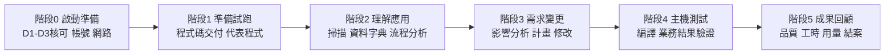

# Bob + PPZ POC 現場操作小抄（STE 精簡寫法版｜Bob／PPZ 自動化改寫版）

| 項目 | 內容 |
|---|---|
| 版本 | v1.2-STE-AI（由 v1.1-STE-AI 修訂。已依官方 Premium Package for Z 文件修正模式、版本與指令） |
| 對應原稿 | `cheatsheet_STE.md` v1.0-STE |
| 本版改動 | 1. 新增 1.4 節：各步驟卡的執行方式分類。 2. 每張步驟卡新增「執行方式」欄。 3. 在各步驟下方直接加入「💬 Bob 提示詞」。 4. 步驟卡 E 改由 Bob 依 `AGENTS.md` 自動檢查。 5. v1.2：依官方文件修正（見下方修訂紀錄）。 |
| 讀者 | 聯邦銀行 POC 現場人員：BIZ、DEV、MF、SEC、NET、BOB |
| 適用情境 | IBM Bob IDE + Premium Package for Z（PPZ），Local Workspace 模式。不建立中央 Z Understand。 |
| 參考依據 | 《POC 需求訪談簡報》、《防火牆與 AP 開發機需求 20261007》、《IBMid 註冊操作指南》、《變更請求範本》、Bob 內建技能（資料字典、影響分析、實施計畫）；官方文件 `bob.ibm.com/docs/ide/premium-packages/bob-for-z/` |
| 使用方式 | 1. 讀第 1 節，找出目前階段。 2. 到對應的步驟卡。 3. 依序執行步驟並勾選。 4. 遇到問題時，查第 5 節。 |

> **注意**：本小抄的畫面名稱、指令與路徑，以現場安裝版本為準。畫面與本小抄不同時，以畫面為準。請回報差異。

### v1.2 修訂紀錄（對照 v1.1-STE-AI）

| # | 修訂內容 | 依據 |
|---|---|---|
| 1 | Explain code、Generate program documentation、Extract business rules、Generate data dictionary 的模式是 **Z Code**。Generate application documentation 的模式是 **Z Architect**。 | 官方「Workflows」頁 |
| 2 | 版本需求：Bob IDE **2.3.0 以上**、Z Open Editor **6.9.0 以上**、Zowe Explorer **3.6.0 以上**。 | 官方「Prerequisites」頁 |
| 3 | 步驟卡 F 新增 `/init`。每個工作區第一次執行工作流程前，必須先執行。 | 官方「Getting started」頁 |
| 4 | `/explain` 與 explain 技能在 3.0.20 以上版本不支援。改用 Start Workflow 的 **Explain code**。 | 官方「Commands」「Skills」頁 |
| 5 | 新增 `/impact-analysis`、`/implementation-planning`、`/data-dictionary-management` 作為替代入口。 | 官方「Commands」頁 |
| 6 | `local-settings.json` 的實際路徑是 `.bobz/local-settings.json`。 | 擴充套件內建 Skill 說明 |
| 7 | `get_program_dependencies` 未列於官方工具表。標註「現場實測確認」，並提供 `execute_sql_query` 替代做法。 | 官方「Tools」頁 |
| 8 | `zopeneditor-*` 流程工具屬 **zOpenEditor-architect** 群組。只在 Z Architect 模式提供。 | 官方「Tools」頁 |
| 9 | Java 21 需求未見於官方 PPZ 文件。保留 v1.0 記載，標註「待確認」。 | 官方「Prerequisites」頁未列 |

---

## 0. 寫作規則（STE 精神）

本版依 ASD-STE100（Simplified Technical English）的精神，用中文改寫。規則如下：

| 規則 | 做法 |
|---|---|
| 一句一事 | 每個步驟只寫一個動作。 |
| 短句 | 步驟句不超過 25 字。說明句不超過 35 字。 |
| 主動語氣 | 用祈使句開頭：「開啟」「輸入」「確認」。不寫被動句。 |
| 一詞一義 | 同一個東西只用同一個詞（見 0.3 用語表）。 |
| 警告在前 | 「警告」與「注意」放在相關步驟之前。 |
| 條件在前 | 先寫條件，再寫動作：「若……，則……」。 |
| 明確用詞 | 不用「適當」「必要時」「盡量」「視情況」。要寫出數字、名稱或條件。 |
| 步驟編號 | 一定要依順序做的動作用數字編號。 |

### 0.1 用語強度

| 用語 | 意義 |
|---|---|
| **必須** | 強制。不做就不得進入下一步。 |
| **不可** | 禁止。 |
| **可以** | 選擇。做或不做都可以。 |

### 0.2 角色代號

| 代號 | 角色 | 主要職責 |
|---|---|---|
| **BIZ** | 客戶業務專家 | 提供需求與已知答案。核對資料字典語意。 |
| **DEV** | 客戶程式專家 | 交付程式碼。審閱修改內容。 |
| **MF** | 客戶主機窗口 | 提供程式來源與測試環境。執行編譯與測試。 |
| **SEC** | 客戶資安窗口 | 核可資料使用與雲端 AI。核可網路開通。 |
| **NET** | 客戶網路／端點窗口 | 設定防火牆與 Proxy。準備工作站。 |
| **BOB** | Bob／PPZ 顧問 | 設定帳號授權。執行掃描與分析。提出修改建議。主持成果回顧。 |

### 0.3 符號與固定用語

| 符號／用語 | 意義 |
|---|---|
| ☐ | 待確認。確認後改為 ☑。 |
| 🔴 | 卡關項目。未完成，不得進入下一步。 |
| 🟡 | 建議項目。可以與其他步驟同時進行。 |
| 🛑 | 禁止事項。 |
| **警告** | 資料外洩或違反資安規定的風險。 |
| **注意** | 結果錯誤或需要重做的風險。 |
| **工作區** | 存放程式碼的核准資料夾。 |
| **分析資料庫** | `scan_program` 產生的本機 SQLite 資料庫。 |
| **工作流程** | 按 Start Workflow 啟動的引導式流程。 |
| **尚未驗證** | 沒有經過主機測試的項目。 |
| **邊界** | 工具無法確認的項目，例如動態 CALL、缺少的來源、外部介面。 |

---

## 1. 一頁總覽

### 1.1 端到端流程

### 1.2 階段與步驟卡對照

| 階段 | 步驟卡 | 主要負責 | Bob 模式 | 階段完成條件 |
|---|---|---|---|---|
| 0 啟動準備 | A 核可 → B IBMid → C 網路 → D 安裝登入 | SEC／NET／BOB | 不適用 | Bob 能登入，並完整回應一次對話。 |
| 1 準備試跑 | E 程式碼交付 → F 代表程式試跑 | DEV／BOB | Z Code（含 `/init`） | 代表程式可被掃描。結果可回查來源。 |
| 2 理解應用 | G 掃描 → H 資料字典 → I 流程分析 | BOB／BIZ／DEV | Z Code（工作流程）＋Z Architect（流程工具） | 專家已核對資料字典。 |
| 3 需求變更 | J 影響分析 → K 實施計畫 → L 程式修改 | BOB／DEV | Z Architect → Z Code | 計畫已核准，才可修改。DEV 已審閱修改。 |
| 4 主機測試 | M 編譯與測試 | MF／BOB | Z Code | 邊界值測試結果符合預期。 |
| 5 成果回顧 | N 回顧與結案 | BOB／全員 | 不適用 | 報告已簽收。資料已刪除。 |

> **規則**：完成一個階段，才可開始下一個階段。沒有完成主機測試的項目，一律標示「尚未驗證」。

### 1.3 模式選擇

| 要做的事 | 切換到 | 說明 |
|---|---|---|
| 影響分析、實施計畫、系統分析、控制流程與資料流程工具 | **Z Architect** | 只分析與寫文件。**不改程式。** |
| Explain code、程式文件、業務規則、資料字典（工作流程）。改 COBOL／COPY／JCL。 | **Z Code** | 只有此模式可以編輯原始碼。 |
| 產生應用程式文件（HTML） | **Z Architect** | 官方標示此工作流程屬於 Z Architect。 |
| 詢問 Bob 功能或一般問題 | **Ask** | 唯讀。**沒有 PPZ 工具。** |

> 🛑 **注意**：PPZ 功能只在 **Z Code** 和 **Z Architect** 提供。在 Agent、Plan、Ask 模式找不到剖析功能時，先切換模式。

### 1.4 執行方式分類（Bob／PPZ 工具／工作流程／人工）

本版把每張步驟卡分成四種執行方式：

| 代號 | 執行方式 | 說明 | 提示詞 |
|---|---|---|---|
| 🤖 **BOB** | Bob 對話＋專案規則 | 用自然語言提示詞。Bob 讀檔、比對、產出報告。規則寫在 `AGENTS.md`。 | 見各步驟下方 |
| 🛠 **PPZ** | PPZ 工具 | Bob 呼叫底層剖析工具（如掃描、變更分析、控制流程與資料流程工具），用戶直接以自然語言提問即可觸發。 | 見各步驟下方 |
| 🔁 **WF** | 內建工作流程／技能 | 透過「Start Workflow」啟動的引導式流程：**Explain code**、**Generate program documentation**、**Generate application documentation**、**Extract business rules**；或專屬技能：資料字典、影響分析、實施計畫。 | 見各步驟下方 |
| 👤 **人工** | 人員操作 | 核可、帳號、網路、主機編譯與測試、簽收。AI 不可取代。 | 無（Bob 只可起草文件） |

| 步驟卡 | 主要執行方式 | 適合交給 Bob／PPZ 的部分 | 必須由人工完成的部分 |
|---|---|---|---|
| A 三項核可 | 👤 人工 | Bob 可以起草向核可人說明 D1／D2／D3 的文字。 | 取得核可與簽署。 |
| B IBMid 註冊 | 👤 人工 | 無。 | 每位使用者自行註冊與驗證。 |
| C 防火牆與 Proxy | 👤 人工 | Bob 可以整理端點清單，產生給 NET 的申請表。 | NET 與 SEC 開通規則。 |
| D 安裝登入 | 👤 人工 | Bob 回應「自我介紹」，用來驗證登入。 | 安裝、登入、元件確認。 |
| E 交付完整性檢查 | 🤖 BOB（依 `AGENTS.md`） | 目錄結構、MANIFEST 比對、COPY／CALL 相依、中介軟體偵測、JCL 相依、產生報告。 | DEV 交付與補件。SEC 判定是否含未脫敏資料。 |
| F 代表程式試跑 | 🤖 BOB | 說明程式用途與規則，標註行號。 | DEV 與 BIZ 核對說明。記錄回應時間與記憶體。 |
| G 掃描建庫 | 🛠 PPZ | 掃描代碼、外部相依性分析、內部段落分析（由 Bob 在後台調用剖析服務）。 | 使用者明確同意掃描。 |
| H 資料字典 | 🔁 WF（資料字典技能）＋🛠 PPZ | `get_variables`、描述草稿、DD.json 寫入。 | BIZ 簽核關鍵欄位語意。 |
| I 流程分析與文件 | 🔁 WF＋🛠 PPZ | 四個內建工作流程、控制流程圖、資料流程追蹤。 | DEV 與 BIZ 核對。 |
| J 影響分析 | 🔁 WF（影響分析技能）＋🛠 PPZ | 本機 SQL 查詢、資料流程追蹤、產生 `IMPACT-ANALYSIS.md`。 | 回答釐清問題。專案負責人核可。 |
| K 實施計畫 | 🔁 WF（實施計畫技能） | 產生計畫，含測試策略與回退計畫。 | DEV、MF、BIZ 審閱與核准。 |
| L 程式修改 | 🤖 BOB（Z Code） | 依計畫修改、產生 Diff、格式化、程式碼掃描。 | DEV 逐行審閱。**不可**整批接受。 |
| M 編譯與測試 | 👤 人工（Bob 輔助） | 產生測試清單與預期結果。判讀編譯訊息。比對 SYSOUT。 | MF 編譯、執行、加密回傳。 |
| N 回顧與結案 | 🤖 BOB 輔助＋👤 人工 | 計算 Precision／Recall。彙整報告初稿。 | 開啟已知答案、簽收、刪除資料、書面確認。 |

> **判斷原則**：
> - 需要讀大量程式碼、比對、彙整 → 交給 🤖 BOB。
> - 需要可重複、可稽核的結構化結果（資料庫、DD.json） → 交給 🛠 PPZ。
> - 需要固定格式的正式文件 → 交給 🔁 WF。
> - 涉及核可、簽署、主機執行、資料刪除 → 保留 👤 人工。

#### 1.4.1 工作流程、技能、斜線指令對照（官方）

| 要做的事 | 工作流程（Start Workflow） | 斜線指令或直接提問 |
|---|---|---|
| 初始化工作區 | 無 | `/init`（產生 `AGENTS.md`） |
| 整支程式解釋 | **Explain code**（Z Code） | **不可**用 `/explain`（3.0.20 以上不支援） |
| 資料字典 | **Generate data dictionary**（Z Code） | `/data-dictionary-management` |
| 程式文件 | **Generate program documentation**（Z Code） | 無 |
| 應用程式文件（HTML） | **Generate application documentation**（Z Architect） | 無 |
| 業務規則 | **Extract business rules**（Z Code） | 無 |
| 影響分析 | 無（技能） | `/impact-analysis`，或直接要求「影響分析」（Z Architect） |
| 實施計畫 | 無（技能） | `/implementation-planning`，或直接要求「建立實施計畫」（Z Architect） |

> 官方建議：多階段任務用工作流程，例如解釋整支程式、產生完整文件。小範圍修改、快速查詢、單檔編輯用直接提問。

---

## 2. 啟動前總檢核（Go／No-Go）

> 🔴 項目只要有一項未完成，就**不可**接收程式碼，也**不可**開始 AI 驗證。

| # | 項目 | 等級 | 確認人 | 狀態 |
|---|---|---|---|---|
| 1 | D1：允許 Bob 連入主機（可以改為「客戶代操作」） | 🟡 | MF | ☐ |
| 2 | D2：允許將程式下載到核准的 Bob＋PPZ 工作站 | 🔴 | MF | ☐ |
| 3 | D3：允許 Bob SaaS 使用必要內容來協助理解 | 🔴 | SEC | ☐ |
| 4 | 已決定資料使用範圍（程式片段／完整程式／須脫敏） | 🔴 | SEC | ☐ |
| 5 | 已選定變更案例與驗收基準（含已知答案的提供方式） | 🔴 | BIZ | ☐ |
| 6 | 每位使用者都有 IBMid，且 Email 與公司指定的一致 | 🔴 | 各使用者 | ☐ |
| 7 | 防火牆與 Proxy 已開通，且登入與對話驗證已完成 | 🔴 | NET | ☐ |
| 8 | 已備妥程式碼交付清單（MANIFEST）與校驗碼 | 🔴 | DEV | ☐ |
| 9 | 已預約主機測試窗口、LPAR、測試資料 | 🟡 | MF | ☐ |
| 10 | 已確認各窗口聯絡方式與緊急聯絡人 | 🟡 | 專案負責人 | ☐ |

> 🛑 **警告**：不可將下列資料交給 Bob：
> - 個人敏感資料（SPI）
> - 個人健康資料
> - 可識別的帳號、卡號、身分證號等敏感金融資料
> - 尚未公開的重大資訊
> - 非 IBM 授權範圍的第三方智慧財產
>
> 程式碼必須先依 SEC 核可的規則脫敏。

---

## 3. 步驟卡

每張步驟卡的順序相同：**負責 → 前置條件 → 步驟 → 預期結果 → 問題處理**。

### 步驟卡 A：取得三項核可（D1／D2／D3）

**負責**：MF（D1、D2）、SEC（D3）
**執行方式**：👤 人工。Bob 只可起草說明文字。

**前置條件**
- 變更請求已提交。
- 範圍（子流程、語言、元件）已列明。

**步驟**
1. 向核可人說明 D1 的用途：Bob 連入主機。
2. 向核可人說明 D2 的用途：程式下載到工作站。
3. 向核可人說明 D3 的用途：雲端 AI 協助理解。
   - 💬 **Bob 提示詞**：`請起草向核可人說明 D1、D2、D3 用途的說明文字。每項不超過 100 字。內容包含用途、資料範圍與風險控管。不可代為核可。`
4. 請各核可人在變更請求第 6.1 節填寫結果、日期與限制條件。
5. 若 D1 不允許，改用「客戶代操作＋結果回傳」。
6. 事先準備代操作的步驟清單。
   - 💬 **Bob 提示詞**：`請起草 D1 不允許時的「客戶代操作＋結果回傳」步驟清單。請列出每一步的操作者（MF）、輸入、輸出與回傳格式。`

**預期結果**
- D1、D2、D3 都有明確結果與核可人簽署。
- D2 與 D3 的結果是「允許」。

**問題處理**

| 條件 | 動作 |
|---|---|
| D2 或 D3 未核可 | 暫停接收程式碼。申請以已脫敏的小範圍樣本試跑。 |
| D1 不允許 | 啟動代操作流程。在風險表登記「測試階段可能延遲」。 |
| 核可附帶限制 | 將限制寫入備註。後續每一步都必須遵守。 |

---

### 步驟卡 B：IBMid 註冊與確認

**負責**：每位使用者。BOB 協助。
**執行方式**：👤 人工。

**前置條件**
- 使用者有公司指定的 Email。
- 使用者可以收信。

**步驟**
1. 開啟 IBMid 註冊頁。
2. 輸入 Email、名字、姓氏。
3. 國家選擇 **Taiwan**。
4. 公司欄位輸入 **Union Bank of Taiwan**。
5. 從建議清單選擇 UNION BANK OF TAIWAN。
6. 設定您的密碼。
   - **注意**：長度須為 12 至 63 字元。
   - **注意**：須包含大小寫英文字母與數字。
   - **🛑 禁止**：不可使用全形字元。
7. 到信箱找出寄件者為 ibmacct 的驗證信。
8. 輸入 **7 位數驗證碼**。驗證碼 30 分鐘內有效。
9. 進入 My IBM 後，開啟無痕視窗。
10. 用同一個 Email 重新登入。
11. 在 Profile 確認 IBMid 與 Email 都是公司指定的地址。

**預期結果**
- 使用者可以獨立登入 My IBM。
- Profile 顯示正確的 Email。
- 畫面顯示「您似乎沒有任何產品」。這是正常現象。不需申請產品。

**問題處理**

| 條件 | 動作 |
|---|---|
| 收不到驗證信 | 1. 檢查垃圾郵件與公司郵件隔離區。 2. 在註冊頁按 resend e-mail。 3. 使用最新的信件。 4. 仍收不到時，請 NET 確認信件是否被攔截。 |
| 驗證碼過期 | 重新寄送。使用最新的驗證碼。 |
| Email 已有 IBMid | 直接登入。不重複建立。若與公司指定 Email 不同，先問專案窗口該用哪一個。 |
| 忘記密碼 | 使用 IBM 官方密碼重設頁。重設後確認可登入。 |
| 已註冊但 Bob 不能用 | IBMid 與 Bob 使用權限是兩件事。請 BOB 確認授權設定。 |

---

### 步驟卡 C：防火牆與 Proxy 開通

**負責**：NET、SEC。BOB 提供清單。
**執行方式**：👤 人工。Bob 可以整理端點清單與申請表。

**前置條件**
- 已確認 Bob 的訂閱區域（例如日本）。
- 已知出口 Proxy 路徑。

**步驟**
1. 從使用者開發機（或核准的出口 Proxy）開通**向外**的 **HTTPS／TCP 443**。
2. 使用網域白名單。官方沒有提供固定 IP。
3. 申請開通下列 8 個共同端點。
   - 共同端點清單：`bob.ibm.com`、`api.us-east.bob.ibm.com`、`iam.cloud.ibm.com`、`console-ibm-prod.verify.ibm.com`、`idaas.ice.ibmcloud.com`、`www.ibm.com`、`login.ibm.com`、`myibm.ibm.com`。
   - 💬 **Bob 提示詞**：`請把本步驟的 8 個共同端點與 〈訂閱區域，如：日本〉 的區域端點，整理成給網絡窗口（NET）的防火牆申請表。欄位包含：網域、協定、埠號、方向、用途。`
4. 開通 `api.us-east.bob.ibm.com`。即使訂閱區域為日本或歐洲，共用驗證也位於美東。
5. 依訂閱區域補上區域端點，例如 `*.ice.ibmcloud.com`。
6. 在實際登入時，補開被擋的網域。
7. 保持 Proxy 的 Strict SSL 為啟用。
8. 若網路有 TLS 檢查，請 NET 與 SEC 確認企業根憑證在信任鏈中。

**預期結果**
- 規則生效後，工作站可以連到上述網域。
- 實際登入驗證在步驟卡 D 進行。

**問題處理**

| 條件 | 動作 |
|---|---|
| 登入頁打不開 | 用瀏覽器測試 `bob.ibm.com` 與 `login.ibm.com`。補開打不開的網域。 |
| 出現憑證錯誤（SSL） | **不可**關閉 Strict SSL。請 NET 將企業根憑證加入信任鏈。 |
| 只有部分端點可通 | 執行實際登入流程。記錄被擋的網域。逐一補開。 |
| 客戶要求證明連線方向 | 說明這是 Outbound 連線。回應經由既有連線返回。請 NET 確認沿途 ACL 與回程路徑。 |

---

### 步驟卡 D：安裝 Bob IDE／PPZ 並驗證登入

**負責**：NET（工作站）、BOB（帳號授權與元件）
**執行方式**：👤 人工。用 Bob 的一句話回應驗證登入。

**前置條件**
- 步驟卡 B 與 C 已完成。
- 工作站符合建議規格。

**步驟**
1. 檢查工作站規格：16 GB RAM、近年 4 核心以上 CPU、SSD 可用空間 20 GB 以上。
2. 安裝與工作站作業系統相符的 Bob IDE。版本必須是 **2.3.0 以上**。
3. 以 VSIX 安裝或確認下列元件：
   - PPZ（IBM Bob Premium Package for Z）
   - IBM Z Open Editor **6.9.0 以上**
   - VS Code Extension for Zowe Explorer **3.6.0 以上**
4. 確認 Java 21 以上（64 位元）。此項來自 v1.0，官方 PPZ 文件未列，**待確認**。
5. 重啟 Bob。
6. 在瀏覽器完成登入。
7. 返回 IDE。
8. 在 Bob 面板輸入「請用一句話自我介紹」。
   - 💬 **Bob 提示詞**：`請用一句話介紹你自己。`
9. 確認 Bob 回應完整。
10. 確認聊天面板上方有 **Start Workflow** 按鈕。
11. 確認模式選單有 **Z Code** 與 **Z Architect**。

**備註**：官方最低需求是 4 GB RAM。官方建議值是 8 GB。安裝至少需要 500 MB。本 POC 採用較高的規格。

**預期結果**
- 登入成功。
- 對話有完整回應。
- IDE 中可看到 PPZ 功能（掃描、資料字典）。

**問題處理**

| 條件 | 動作 |
|---|---|
| 登入後無法返回 IDE | 檢查瀏覽器是否阻擋轉址。重啟 Bob。重試。 |
| 對話中斷或無回應 | 回步驟卡 C，檢查 Proxy 與 TLS。確認端點防護沒有攔截。 |
| 元件缺漏或版本不符 | BOB 提供相容版本。NET 評估安裝權限。 |
| 看不到 Z Code 或 Z Architect | 確認 PPZ 已指派給使用者並已安裝。啟動 Bob 時若出現安裝通知，按 Install。 |
| 記憶體不足 | 關閉不需要的程式。若同機執行容器或虛擬機，評估升級到 32 GB。 |

---

### 步驟卡 E：程式碼交付與完整性檢查

**負責**：DEV（交付）、BOB（檢查）
**執行方式**：🤖 BOB。Bob 依 `AGENTS.md` 步驟 1 至 7 自動檢查。提示詞見各步驟下方。

**前置條件**
- D2 已核可。
- SEC 已核可脫敏規則。
- 已決定工作區位置（例如 `D:\POC-SOURCE`）。

**步驟**
1. 將從客戶處取得之代碼交付壓縮檔（例如 `UNION_BANK_POC.zip`）直接放置於工作區核准路徑。
2. 貼下一鍵交付完整性檢查提示詞。
   - 💬 **Bob 提示詞**：`這是我剛拿到的客戶交付壓縮包 〈UNION_BANK_POC.zip〉（若有密碼，密碼為 〈Ubot1234〉）。我已取得 D2 授權。請一鍵幫我跑完步驟卡 E 的 1 至 7 步完整性稽核：(1) 在背景自動將其解壓縮至工作區核准路徑；(2) 自動解析內含之 MANIFEST.csv 宣告與 README.txt 編譯環境，比對宣告數與解壓縮後的實際檔數；(3) 自動計算工作區所有實體檔案的 SHA-256 哈希值並與 MANIFEST.csv 比對，抓出校驗碼不符或空白之項目；(4) 自動唯讀掃描所有 COBOL、Copybook、JCL 的交叉相依性（COPY/CALL 關係與缺失項目），偵測 CICS/DB2/IMS/MQ 等中介軟體關鍵字；(5) 自動彙整並輸出完整的《步驟卡 E — 程式碼交付完整性檢查報告》，並將報告自動存檔於 `.bobz/step-E-delivery-check-[日期].md`。`

**預期結果**
- 檔案數量與校驗碼一致。
- 缺失項目與動態呼叫已列入邊界清單。

**問題處理**

| 條件 | 動作 |
|---|---|
| 校驗碼不符 | 要求重新傳送。**不可**使用版本不確定的檔案。 |
| 缺少 COPY、JCL 或 PROC | 登記為邊界。判斷是否影響本變更。若有影響，請 DEV 補件。 |
| 出現亂碼 | 確認編碼轉換（EBCDIC → UTF-8）與編碼頁。請 DEV 重新轉檔。 |
| 含有未脫敏資料 | 🛑 立即停止使用。通知 SEC。依 SEC 指示處理。 |

---

### 步驟卡 F：代表程式試跑

**負責**：BOB 主導。DEV 與 BIZ 共同檢視。
**執行方式**：🤖 BOB。提示詞見各步驟下方。

**前置條件**
- 步驟卡 D 與 E 已完成。

> **注意**：每個工作區第一次執行工作流程前，必須先執行 `/init`。

**步驟**
1. 選 1 支代表性 COBOL 程式及其 COPY。
2. 切換到 **Z Code** 模式。
3. 在聊天輸入 `/init`，按 Enter。確認工作區產生了 `AGENTS.md`。若 `AGENTS.md` 已存在，先確認內容，不要覆蓋 POC 規則。
4. 請 Bob 說明程式用途與主要規則（提示詞見第 4 節）。可以按 **Start Workflow**，選 **Explain code**。🛑 **不可**用 `/explain`。3.0.20 以上版本不支援。
   - 💬 **Bob 提示詞**：`請以架構師視角說明 〈CHKRTN01.cbl〉 的用途、主要處理步驟與關鍵業務規則。每一項請標註行號或段落名稱。`
5. DEV 與 BIZ 對照原始碼，核對說明。
   - 💬 **Bob 提示詞**：`請列出你上述每項說明所依據的行號與原始碼片段。無法確認的項目請標示「邊界」。`
6. 記錄回應時間。
7. 記錄記憶體使用量。
8. 記錄解析錯誤。這些紀錄是後續配置的依據。

**預期結果**
- 說明與原始碼相符。
- 說明可回查到程式段落。
- 可以進入完整分析。

**問題處理**

| 條件 | 動作 |
|---|---|
| 說明與程式不符 | 要求 Bob 指出依據的行號。補充業務詞彙。重新提問。 |
| 解析失敗 | 檢查編碼、固定格式欄位、COPY 搜尋順序。縮小範圍後重試。 |
| 找不到 COPY 或相依檔 | 確認 COPY 路徑設定正確。確認成員在 Bob 可存取的目錄內。 |
| 大型程式處理失敗 | 增加 IDE 的記憶體配置。 |
| 回應太慢 | 縮小提問範圍到單一段落或單一欄位。 |

---

### 步驟卡 G：掃描程式碼、建立分析資料庫

**負責**：BOB
**執行方式**：🛠 PPZ（由 Bob 在後台一鍵合流處理並自動更新設定）。

**前置條件**
- 步驟卡 F 已通過。
- 使用者已**明確同意**對工作區進行掃描建庫。

**步驟**
1. 確認工作區已開啟正確之資料夾。
2. 貼下一鍵掃描與剖析提示詞。
   - 💬 **Bob 提示詞**：`我同意對本專案進行掃描建庫。請執行以下一鍵剖析：(1) 在背景自動對工作區進行掃描建庫，並將資料庫路徑寫入 .bobz/local-settings.json 的 databaseLocation 欄位；(2) 掃描完成後，直接對變更目標 〈CHKRTN01〉 及其相依程式進行呼叫關係與內部段落（Paragraph）結構分析；(3) 自動彙整並輸出 DL-01 掃描結果摘要報告。`

**預期結果**
*   **【實體檔案產出與更新】**：
    *   **更新檔**：`.bobz/local-settings.json`（設定檔中 `databaseLocation` 欄位會填入 SQLite 資料庫之絕對路徑）。
    *   **產生檔**：本機 SQLite 分析資料庫檔案（由 `.bobz/local-settings.json` 指定路徑，例如 `bobz/ScannerOutput_result.db` 或鄰近資料夾）。
*   **相依查詢**：可透過自然語言或 SQL 查詢取得完整的程式、COPYBOOK、DB2 資料表、JCL、外部檔案之相依關係與呼叫圖。
*   **階段交付物**：完成 **DL-01：程式掃描結果／相依關係圖**。

**問題處理**

| 條件 | 動作 |
|---|---|
| 顯示 No supported files found | 確認資料夾路徑。確認副檔名是 `.cbl`、`.cob`、`.cobol`、`.pli` 或 `.pl1`。 |
| 使用者拒絕掃描 | **不可**強制執行。改用 Z Architect 模式的控制流程與資料流程工具做有限分析。在報告註明限制。 |
| 資料庫路徑錯誤 | 檢查設定檔路徑。必要時重新掃描。 |
| 範圍太大，逾時 | 分批掃描。先掃變更目標及其相依，再擴大範圍。 |

---

### 步驟卡 H：建立資料字典（反向工程）

**負責**：BOB 產出。BIZ 與 DEV 核對語意。
**執行方式**：🔁 WF（資料字典技能）＋🛠 PPZ（`get_variables`）。提示詞見各步驟下方。

**前置條件**
- 步驟卡 G 已完成。
- 分析資料庫存在。
- 專案程式碼必須已先完成「掃描建庫」。這是提取變數前的官方要求。

**步驟**
1. 切換到 **Z Code** 模式。在對話框輸入 `/data-dictionary-management`，或點選 **Start Workflow** 選擇 **Generate data dictionary**。
2. 貼下一鍵建立資料字典提示詞。
   - 💬 **Bob 提示詞**：`請幫我為 〈CHKRTN01〉 一鍵建立資料字典：(1) 自動提取前 〈15〉 個最關鍵的業務變數並聚焦於與 〈手續費〉 相關之欄位；(2) 自動展開縮寫並為變數生成詳細的語意描述（若工具出錯請立即停止，不可人工猜測）；(3) 自動產出實體 `bobz/DD.json`，並自我核對確保每個項目的 scope 陣列均含 〈CHKRTN01〉；(4) 請將最終產出的字典清單與縮寫對照，以表格形式呈現在對話框中。`
3. 在差異檢視畫面逐項快速確認。
4. 請 BIZ 簽核關鍵欄位（手續費、金額等）的業務語意。

**預期結果**
*   **【實體檔案產出與更新】**：
    *   **產生檔**：`bobz/DD.json`（資料字典實體 JSON 檔案，包含已提取之關鍵變數、展開描述及 programName 範圍）。
*   **語意覆蓋**：`DD.json` 已完整覆蓋所有與本次變更相關之手續費、金額等關鍵業務欄位，並包含業務專家的核對描述。
*   **自動載入**：之後當 Bob 讀取 COBOL 程式或 COPYBOOK 時，會自動於背景讀入並結合 `bobz/DD.json` 的語意。
*   **階段交付物**：完成 **DL-03：資料字典**。

**問題處理**

| 條件 | 動作 |
|---|---|
| `get_variables` 回傳錯誤 | 停止。回報完整錯誤內容。**不可**用人工猜測取代。 |
| 差異檢視沒有變化 | 這是正常現象。欄位已存在，且範圍已含此程式。 |
| JSON 格式錯誤 | 檢查引號與逗號。檢查 `scope` 格式：`[{"programName":"PROG1"}]`。 |
| 程式修改後字典過期 | 重新執行 `get_variables`。工具只會對新增欄位提示。 |
| 一次處理的程式太多 | 官方提醒：批次產生有程式數與檔案大小上限。請分成小批次。 |

---

### 步驟卡 I：流程分析與文件產生

**負責**：BOB。DEV 與 BIZ 核對。
**執行方式**：🔁 WF＋🛠 PPZ。提示詞見各步驟下方.

**前置條件**
- 資料字典已建立，或已確認略過。

**步驟**
1. 切換到 **Z Code** 模式。
2. 貼下一鍵剖析說明與規則提煉提示詞。
   - 💬 **Bob 提示詞**：`請幫我對 〈CHKRTN01.cbl〉 執行一鍵剖析：(1) 以 〈架構師／業務／開發者〉 視角解釋整支程式，並為每項關鍵判斷、業務規則或主要處理步驟標註來源行號；(2) 自動提煉業務規則（Extract business rules）並形成 Markdown 報告；(3) 繪製 Mermaid 格式之內部段落控制流程圖；(4) 追蹤關鍵欄位 〈WS-FEE-AMT〉 於程式中被讀取、寫入與傳遞的所有位置。`
3. 若需要產生正式程式文件與跨程式 HTML 文件，點選 **Start Workflow**，執行 **Generate program documentation** 與 **Generate application documentation**。

**預期結果**
*   **【實體檔案產出與更新】**：
    *   **產生檔**：於工作區儲存 `[程式名]-explanation.md`（程式說明書）或 `[程式名]-BRD.md`（業務規則書），路徑依現場配置。
*   **分析報告**：取得完整的流程分析說明（包括外部介面、關鍵判斷邏輯，每項皆標註行號）。
*   **控制與資料流**：取得 Mermaid 格式的段落控制流程圖，及 WS 欄位之讀寫追蹤紀錄。
*   **階段交付物**：完成 **DL-02：流程分析報告**。

**問題處理**

| 條件 | 動作 |
|---|---|
| 整份解釋太長 | 改問指定行號範圍或單一段落。 |
| 動態 CALL 無法解析 | 請 DEV 補充已知目標。仍未知的項目列為「尚未驗證」。 |
| 語意有爭議 | 以 BIZ 簽核為準。更新資料字典。 |
| 找不到 `zopeneditor-*` 工具 | 確認目前是 Z Architect 模式。 |

---

### 步驟卡 J：影響分析

**負責**：BOB。DEV 與 BIZ 回答釐清問題。
**執行方式**：🔁 WF（影響分析技能）＋🛠 PPZ（本機 SQL）。提示詞見各步驟下方。

**前置條件**
- 變更需求清楚：現況、期望、驗收標準。
- **尚未**把已知答案給 Bob。這樣可以保持評估客觀。

**步驟**
1. 切換到 Z Architect 模式。
2. 輸入 `/impact-analysis`，或要求 Bob 做「**影響分析**」。Bob 會啟動影響分析技能。
   - 💬 **Bob 提示詞**：`請針對「〈變更標題〉」做影響分析。請使用本機（Local）分析資料庫。請列出受影響的程式、COPY、表、檔案與批次。請標示邊界與尚未驗證的項目。`
3. 讓 Bob 用本機資料庫的 SQL 查詢，找出受影響的程式、COPY、表、檔案。
4. 讓 Bob 對變更欄位做資料流程追蹤，找出上下游。
   - 💬 **Bob 提示詞**：`請對 〈WS-FEE-AMT〉 做資料流程追蹤。請列出上游來源與下游使用處，並標註程式與行號。`
5. 回答 Bob 的 1 至 2 個釐清問題。例如：其他系統是否直接讀取同一張表？
   - 💬 **Bob 提示詞**：`〈直接回答 Bob 的問題。若不確定，回答「不確定」。不要猜測。〉`
6. 當 Bob 詢問是否另用 Z Understand 做更廣泛分析時，選「否」。本次是 Local 模式。若另有安排，則依安排處理。
7. 取得 `IMPACT-ANALYSIS.md`（DL-04）。
8. 確認報告含相依圖、風險表、信心等級。
   - 💬 **Bob 提示詞**：`請檢查 IMPACT-ANALYSIS.md 是否含相依圖、風險表與信心等級。請列出缺少的項目，並對每個受影響項目附上依據（CALL、COPY 或檔案存取位置）。`

**預期結果**
*   **【實體檔案產出與更新】**：
    *   **產生檔**：工作區根目錄下產生 `IMPACT-ANALYSIS.md`（變更影響分析報告）。
*   **相依性與風險**：報告中包含相依性關係圖、潛在風險表、變更信心等級，以及動態呼叫與缺失來源等「邊界」項目清單。
*   **階段交付物**：完成 **DL-04：影響分析報告**。

**問題處理**

| 條件 | 動作 |
|---|---|
| 清單可能漏列 | 請 DEV 補充間接相依（共用 COPY、批次 JCL）。重新查詢。 |
| 清單可能誤列 | 要求 Bob 附上依據（CALL、COPY 或檔案存取位置）。逐項驗證。 |
| 報告過長（上限約 1000 行） | 要求 Bob 拆成多份聚焦報告。 |

---

### 步驟卡 K：實施計畫

**負責**：BOB。DEV 審閱。
**執行方式**：🔁 WF（實施計畫技能）。提示詞見各步驟下方。

**前置條件**
- 步驟卡 J 已完成。
- 所有涉及的程式都有資料字典。缺少的，先補建。

**步驟**
1. 在 **Z Architect** 模式，輸入 `/implementation-planning`，或要求 Bob「**建立實施計畫**」。Bob 會啟動實施規劃技能。
   - 💬 **Bob 提示詞**：`請依影響分析報告 〈路徑〉，建立實施計畫。計畫必須含目標與非目標、工作流、執行順序、受影響元件、風險、測試策略與回退計畫。`
2. 回答 Bob 的開放問題：邊界值、例外情形、部署時機。
3. 檢查計畫是否包含下列項目：
   - 目標與非目標
   - 工作流
   - 執行順序
   - 受影響元件
   - 風險
   - **測試策略**
   - **回退計畫**
   - 💬 **Bob 提示詞**：`請檢查實施計畫是否含測試案例（面額 100,000 與 100,001）與回退步驟。請列出缺少的項目並補上。`
4. 請 DEV、MF、BIZ 審閱。
5. 取得核准。
6. 將計畫存為 `implementation-plan.md`（DL-05）。

**預期結果**
*   **【實體檔案產出與更新】**：
    *   **產生檔**：工作區根目錄下產生 `implementation-plan.md`（實施計畫書）。
*   **計畫合規**：計畫中完整載入目標與非目標、工作流、執行順序、受影響元件、風險評估、**測試策略**（含邊界值案例）、及**回退計畫**。
*   **階段交付物**：完成 **DL-05：實施計畫**。

**問題處理**

| 條件 | 動作 |
|---|---|
| 計畫缺測試案例 | 補入驗收基準，例如面額 100,000 與 100,001 的邊界值。 |
| 涉及的程式缺資料字典 | 先在 Z Code 子任務補建。再回來定案。 |
| 範圍擴大 | 對照變更請求的「範圍外」。超出的部分，另提變更請求。 |

---

### 步驟卡 L：程式修改與審查（Z Code）

**負責**：BOB 提出建議。DEV 逐項審閱。
**執行方式**：🤖 BOB（Z Code 模式）。提示詞見各步驟下方。

**前置條件**
- 實施計畫已核准。
- 原始碼已備份，或在版本控制下。

> **注意**：Z Architect 模式不能改程式。必須切換到 Z Code。

**步驟**
1. 切換到 **Z Code** 模式。
2. 貼下一鍵修改、診斷與審查彙整提示詞。
   - 💬 **Bob 提示詞**：`請依已核准的 implementation-plan.md 對專案進行程式修改：(1) 修改 〈CHKFEE01.cpy〉 與 〈CHKRTN01.cbl〉，嚴格維持固定格式 7–72 欄，且不超出計畫範圍；(2) 修改完成後，自動呼叫 get_diagnostics 工具對上述兩個檔案進行語法與編譯前診斷，確保 100% 無語法與編譯錯誤（若發現診斷問題請立即修復，直至診斷完全乾淨為止）；(3) 產生修改前後的 Diff 差異摘要，並自動彙整為 DL-06 審查記錄報告（包含欄位：檔名、修改位置、對應計畫項目、DEV 審閱結果）。`
3. 開啟 IDE 的差異檢視（Diff），由 DEV 逐行進行最終審核。**不可**整批接受。
4. 若有新增欄位，要求 Bob 自動更新 `bobz/DD.json`。
   - 💬 **Bob 提示詞**：`請幫我更新新增欄位到 bobz/DD.json 字典檔案中，scope 請含 〈CHKRTN01〉。`

**預期結果**
*   **【實體檔案產出與更新】**：
    *   **修改檔**：直接於 `cobol/` 或 `copybook/` 底下更新實體程式碼（如 `CHKRTN01.cbl` 或 `CHKFEE01.cpy`）。
    *   **產生檔**：於工作區儲存 `DL-06-review-record.md`（代碼審查與 Diff 變更紀錄）。
*   **修改精準**：實體代碼變更完全限定在 `implementation-plan.md` 計畫範圍內，無超出範圍之改動。
*   **階段交付物**：完成 **DL-06：程式修改建議（Diff）與審查紀錄**。

**問題處理**

| 條件 | 動作 |
|---|---|
| Bob 修改超出範圍 | 拒絕該段差異。要求 Bob 依計畫範圍重做。 |
| 固定格式破版（超出 72 欄） | 用格式化工具或手動調整。調整後重新審閱。 |
| 懷疑改錯 | 還原到備份版本。用更小的步驟重做。 |

---

### 步驟卡 M：主機編譯與測試（客戶操作並回傳）

**負責**：MF 執行。BOB 協助判讀。
**執行方式**：👤 人工（MF 執行）。Bob 輔助產生清單與判讀。提示詞見各步驟下方。

**前置條件**
- DEV 已核准修改。
- 已備妥測試窗口、LPAR、測試資料、編譯 JCL／PROC。
- 若 D1 不允許，由客戶手動操作。

> 🛑 **警告**：回傳檔案必須加密。回傳前必須遮蔽敏感資料。

**步驟**
1. BOB 提供「編譯＋測試步驟清單」。
   - 💬 **Bob 提示詞**：`請依實施計畫，產生「編譯＋測試步驟清單」。請以表格呈現，供 MF 使用。`
2. BOB 提供預期結果。例如：手續費 150／300／150／300，日終合計 900。
   - 💬 **Bob 提示詞**：`請依實施計畫的測試案例，列出每個案例的輸入與預期結果，含日終合計。`
3. MF 將修改後的程式上傳到測試環境。
4. MF 執行客戶既有的編譯 PROC。
5. MF 執行測試 JCL。
6. MF 收集 SYSOUT 與比對報告。
7. MF 依約定格式加密檔案。
8. MF 經核准的通道回傳檔案。
9. BOB 協助比對結果。
   - 💬 **Bob 提示詞**：`以下是測試 SYSOUT（已遮蔽）。請與預期結果比對。列出通過、失敗與尚未驗證的項目：〈貼上〉`
10. BOB 記錄通過、失敗與尚未驗證的項目（DL-07）。
   - 💬 **Bob 提示詞**：`如有編譯訊息，請定位原因並提出最小修正：〈貼上已遮蔽的訊息〉。請彙整 DL-07 測試結果記錄。`

**預期結果**
- 編譯無錯誤。
- 邊界值測試與日終入帳結果符合預期。

**問題處理**

| 條件 | 動作 |
|---|---|
| 編譯錯誤 | 回傳完整編譯訊息。請 Bob 協助定位。回步驟卡 L 修正。 |
| 結果與預期不符 | 先確認測試資料與基準。再用資料流程找出有差異的欄位。 |
| 測試窗口失效 | 改用備用日期。未測的項目標示「尚未驗證」。 |
| 回傳內容含敏感資料 | 先遮蔽，再回傳。通知 SEC。 |

---

### 步驟卡 N：成果回顧與結案

**負責**：BOB、全員
**執行方式**：🤖 BOB 輔助計算與彙整。👤 人工簽收與刪除資料。提示詞見各步驟下方。

**前置條件**
- 步驟卡 M 已完成，或已列明未完成的範圍。

**步驟**
1. 統計並計算 Precision（精準度）。
   - **計算公式**：找對的數量 ÷ 工具列出的總數量。
   - **⚠️ 注意**：計算前必須獨立人工清點數量兩次，若兩次不符，須清點第三次以確保基數絕對正確。
2. 統計並計算 Recall（召回率）。
   - **計算公式**：找對的數量 ÷ 已知應找的總數量。
   - 💬 **Bob 提示詞**：`以下是工具列出的受影響清單與已知答案清單。請先幫我雙重核對兩份清單的實際項目數量，再計算 Precision 與 Recall 指標。請列出漏列與誤列的項目及原因：〈貼上兩份清單〉`
3. 比對門檻：Precision 與 Recall 都建議在 80% 以上。
4. 開啟密封的已知答案文件。**只有此時才可開啟。**
5. 請 BIZ 與 DEV 共同核對答案。
6. 彙整工時，含審查與修正時間。
7. 彙整 AI 用量。
8. 與人工基線比較。**不可**事先承諾節省比例。
9. 彙整交付物 DL-01 至 DL-08。
   - 💬 **Bob 提示詞**：`請依 DL-01 至 DL-08 的檔案，彙整成果回顧報告初稿。工時與用量欄位留空。`
10. 請相關人員簽收。
11. 結案後 14 天內（依實際約定），刪除工作站上的工作目錄。
12. 取得刪除的書面確認。

**預期結果**
- 成果回顧報告已簽收。
- 資料刪除有書面紀錄。

**問題處理**

| 條件 | 動作 |
|---|---|
| 未達 80% 門檻 | 如實呈現。分析漏列與誤列的原因：缺來源、動態呼叫、語意落差。**不可**為了符合結果而調整答案。 |
| 沒有人工基線 | 用估算值並註明。之後補正。 |
| 刪除範圍有疑義 | 請 SEC 與 NET 共同確認清單。確認後再執行。 |

---

## 4. 常用提示詞

> 提示詞越具體，結果越穩定。請替換 `〈 〉` 內的內容。

| 目的 | 模式 | 提示詞範例 |
|---|---|---|
| 驗證登入 | 任一 | `請用一句話介紹你自己。` |
| 初始化工作區 | Z Code | `/init` |
| 說明整支程式 | Z Code | `請啟動 Explain code 工作流程，說明 〈CHKRTN01.cbl〉。視角是 〈架構師／業務／開發者〉。請標註對應段落。` |
| 說明片段 | Z Code 或 Z Architect | `請說明 〈CHKRTN01.cbl〉 第 〈起〉 至 〈迄〉 行在做什麼。請列出用到的欄位。` |
| 追蹤欄位 | Z Architect | `請追蹤 〈WS-FEE-AMT〉 在 〈CHKRTN01〉 中被讀取、寫入與傳遞的位置。` |
| 建立資料字典 | Z Code | 按 Start Workflow，選 Generate data dictionary。或輸入 `/data-dictionary-management`。請聚焦與手續費相關的欄位。 |
| 影響分析 | Z Architect | `/impact-analysis`。或：`請針對「退票手續費依面額分級」做影響分析。請列出受影響的程式、COPY、表與批次。請標示邊界與尚未驗證的項目。` |
| 實施計畫 | Z Architect | `/implementation-planning`。或：`請為上述變更建立實施計畫。計畫必須含測試案例（面額 100,000 與 100,001）與回退計畫。` |
| 修改程式 | Z Code | `請依已核准的實施計畫修改 〈CHKFEE01.cpy〉 與 〈CHKRTN01.cbl〉。只修改計畫範圍內的內容。請列出差異供審閱。` |
| 判讀編譯錯誤 | Z Code | `以下是編譯訊息。請定位原因，並提出最小修正：〈貼上訊息〉` |

---

## 5. 問題處理總表（依症狀查詢）

| 症狀 | 常見原因 | 立即動作 | 升級對象 |
|---|---|---|---|
| 無法登入 Bob | 防火牆未開通、IBMid 錯誤、Proxy 憑證問題 | 1. 依序測試 `login.ibm.com` 與 `bob.ibm.com`。 2. 確認 Email。 3. 檢查 TLS 信任鏈。 | NET、SEC |
| 登入成功，但對話無回應 | 端點被擋、網路不穩 | 重啟 Bob。檢查 Proxy 與回程路徑。 | NET |
| 登入後仍無 Bob 權限 | IBMid 已註冊，但尚未授權 | 將畫面與錯誤訊息提供給 BOB。 | BOB |
| 找不到專案剖析或掃描功能 | 目前不在 Z Code 或 Z Architect 模式，或 PPZ 未安裝 | 切換到 Z Code 或 Z Architect。確認 PPZ 已安裝。 | BOB |
| 找不到 `zopeneditor-*` 流程工具 | 目前是 Z Code 模式 | 切換到 Z Architect。 | BOB |
| `/explain` 沒有作用 | 3.0.20 以上版本不支援 | 改用 Start Workflow → Explain code。 | BOB |
| 掃描找不到檔案 | 路徑或副檔名錯誤 | 確認資料夾與副檔名。改掃上層資料夾。 | BOB |
| 分析結果與程式不符 | 版本不一致、缺 COPY、編碼錯誤 | 比對 MANIFEST 校驗碼。補件。重新轉換編碼。 | DEV |
| 動態 CALL 無法解析 | 目標在執行期才決定 | 請 DEV 提供已知目標。其餘列為「尚未驗證」。 | DEV |
| 資料字典與程式不同步 | 程式修改後未更新字典 | 重新執行 `get_variables`。 | BOB |
| 專家審查延遲 | 人手不足 | 依約定的回覆時限（例如 3 個工作天）催辦。 | 專案負責人 |
| 主機測試窗口落空 | 排程衝突 | 改用備用日期。未測項目標示「尚未驗證」。 | MF |
| 發現含敏感資料 | 脫敏不完整 | 🛑 **立即停止使用。通知 SEC。** 依 SEC 指示清除。 | SEC |
| 回應品質不穩 | 提問範圍太大 | 縮小範圍。指定程式、行號或欄位。要求 Bob 附上依據。 | BOB |
| Precision 或 Recall 未達標 | 缺來源、語意落差 | 如實呈現。分析原因。不調整答案。 | 專案負責人 |

---

## 6. 現場紀錄表（可複製使用）

### 6.1 每日開工檢查

| 項目 | 結果 |
|---|---|
| 日期／場地／在場人員 | |
| 今日階段與步驟卡 | |
| Bob 登入與對話驗證 | ☐ 通過　☐ 異常：____ |
| 工作區版本與 MANIFEST 一致 | ☐ 是　☐ 否：____ |
| 今日預計產出 | |

### 6.2 事件紀錄

| 時間 | 步驟卡 | 症狀 | 處置 | 結果 | 負責人 | 是否升級 |
|---|---|---|---|---|---|---|
| | | | | | | |

### 6.3 決策與核可紀錄

| 日期 | 決策事項 | 結論 | 核可人 | 附帶限制 |
|---|---|---|---|---|
| | | | | |

### 6.4 尚未驗證項目清單

| 編號 | 項目 | 原因（動態呼叫／缺來源／未測試） | 後續處理 |
|---|---|---|---|
| | | | |

---

## 7. 收工前檢核與資料保護

| 項目 | 確認 |
|---|---|
| 今日產出（報告、DD.json、Diff）已存檔，檔名含日期 | ☐ |
| 事件紀錄與尚未驗證清單已更新 | ☐ |
| 含程式碼的檔案只存放在核准的工作區 | ☐ |
| 回傳或交付的檔案已加密，密碼已另行通知 | ☐ |
| 沒有將程式碼或結果貼入未核可的外部工具 | ☐ |
| 已通知明日預計步驟與所需窗口 | ☐ |

---

## 8. 交付物對照（驗收用）

| 編號 | 交付物 | 對應步驟卡 | 驗收人 |
|---|---|---|---|
| DL-01 | 程式掃描結果／相依關係圖 | G | DEV |
| DL-02 | 流程分析報告 | I | BIZ |
| DL-03 | 資料字典 | H | BIZ、DEV |
| DL-04 | 影響分析報告 | J | 專案負責人 |
| DL-05 | 實施計畫 | K | 專案負責人 |
| DL-06 | 程式修改建議（Diff） | L | DEV |
| DL-07 | 主機測試結果 | M | MF |
| DL-08 | 成果回顧報告 | N | 專案負責人 |

---

*本小抄整理自專案文件與 Bob 內建工作流程。實際操作以現場核可條件、安裝版本與畫面為準。*
